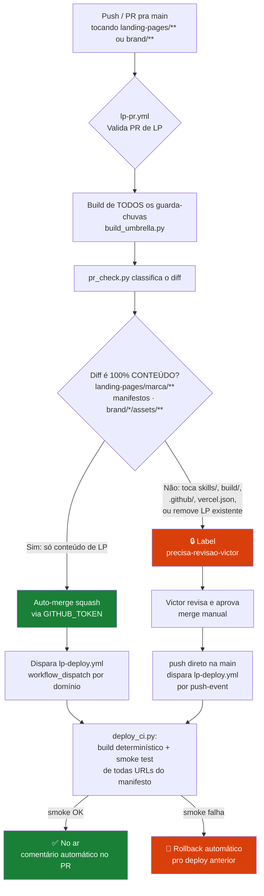

<!-- title: CI/CD de LPs — conteúdo vs mecânica -->

# Fluxo de CI/CD — Landing Pages (guarda-chuva)

## Regra-chave

| Tipo de mudança | Caminho | Gate |
|---|---|---|
| **Conteúdo de LP** (copy, HTML, assets, manifesto) | Auto-merge → auto-deploy | Só precisa passar build+smoke |
| **Mecânica** (skills, `build/`, `.github/`, `vercel.json`) ou **despublicação** de LP | Bloqueado pra revisão humana | Precisa aprovação do Victor |

Isso significa: **alterar uma skill que mexe no pipeline de LP (`lp-preparar`, `lp-gerar`, `lp-publicar`, scripts em `landing-pages/build/`) nunca sobe sozinho** — mesmo que o PR também contenha uma LP nova, o diff inteiro cai em "precisa-revisao-victor" porque toca mecânica, não só conteúdo.

Também há o gate `check_gtm_region.py` (§5.4 do CONTEXT) dentro do `deploy_ci.py`/`pr_check.py`: bloqueia deploy/merge se o container GTM não bater com a região declarada da LP — independe de ser conteúdo ou mecânica.
